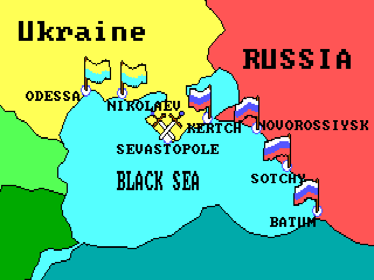
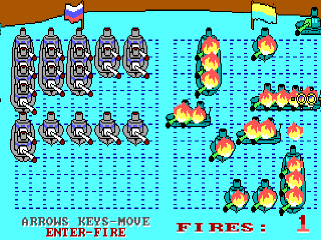

# The Battle on the Black Sea — Морской бой

[English](README.md)

Перенос на Go морской стратегии Владимира Башурова (BADY), выпущенной для DOS в 1992 году. Расставьте десять кораблей, сразитесь с компьютером, пройдите кампанию на Чёрном море и улучшите рекорд своего капитана.

Сохранены оригинальная графика 320×200 в 16 цветах, растровые шрифты, переходы между экранами, боевая анимация и эффекты PC Speaker. Восстановленные процедуры Pascal выполняются как скомпилированные функции Go: расстановка флотов, стратегия компьютера, подсчёт результатов и 16-битная арифметика. Ресурсы встроены в исполняемый файл; DOS и исходный EXE для запуска не требуются. Изображение выводится с пропорциями старого экрана 4:3.




## Управление

| Клавиша | Действие |
| --- | --- |
| Стрелки | Перемещение корабля или прицела |
| Enter | Установка корабля, выстрел, переход с информационного экрана |
| Insert / Page Down | Поворот корабля при расстановке |
| F2 | Дополнительный поворот для клавиатур без Insert |
| F1 | Включение и выключение звука |
| Esc | Выход во время расстановки или боя |
| F11 / Alt+Enter | Полноэкранный режим |
| Backspace | Исправление имени капитана |

Сохранён оригинальный ввод мышью. Имя капитана вводится латиницей. Карточки результатов сохраняются при выходе из игры и закрытии окна в пользовательском каталоге настроек системы, в папке `BattleOnTheBlackSea`.

## Сборка

Установите **Go 1.24 или новее**. Команды выполняются из корня проекта. При первой сборке Go загрузит зависимости, зафиксированные в `go.mod` и `go.sum`.

### Windows — amd64 и arm64

PowerShell в Windows:

```powershell
$env:CGO_ENABLED="0"
$env:GOOS="windows"
$env:GOARCH="amd64"
go build -buildvcs=false -trimpath -ldflags="-s -w -H=windowsgui" -o BattleOnTheBlackSea-windows-amd64.exe .
$env:GOARCH="arm64"
go build -buildvcs=false -trimpath -ldflags="-s -w -H=windowsgui" -o BattleOnTheBlackSea-windows-arm64.exe .
```

Компилятор C не нужен. PNG-иконка встроена и используется окном игры; `icon.ico` приложен для оформления ресурсов исполняемого файла.

### Linux — amd64 и arm64

В Debian/Ubuntu установите зависимости для сборки:

```sh
sudo apt-get install build-essential pkg-config libasound2-dev libx11-dev libxrandr-dev libxcursor-dev libxi-dev libxinerama-dev libxxf86vm-dev libgl1-mesa-dev
```

Собирайте на Linux той же архитектуры, что и целевая система:

```sh
# На Linux amd64:
CGO_ENABLED=1 GOOS=linux GOARCH=amd64 go build -buildvcs=false -trimpath -ldflags="-s -w" -o BattleOnTheBlackSea-linux-amd64 .

# На Linux arm64:
CGO_ENABLED=1 GOOS=linux GOARCH=arm64 go build -buildvcs=false -trimpath -ldflags="-s -w" -o BattleOnTheBlackSea-linux-arm64 .
```

Для запуска нужны X11 либо XWayland, OpenGL и ALSA. Кросс-компиляция Linux arm64 на amd64 дополнительно требует компилятор C для AArch64 и версии перечисленных библиотек для arm64: задайте `CC=aarch64-linux-gnu-gcc`, а в `PKG_CONFIG_LIBDIR` укажите библиотеки целевой архитектуры.

### macOS — Intel и Apple Silicon

Сборка выполняется **на macOS**, с установленными Command Line Tools от Apple:

```sh
xcode-select --install
CGO_ENABLED=1 GOOS=darwin GOARCH=amd64 go build -buildvcs=false -trimpath -ldflags="-s -w" -o BattleOnTheBlackSea-macos-amd64 .
CGO_ENABLED=1 GOOS=darwin GOARCH=arm64 go build -buildvcs=false -trimpath -ldflags="-s -w" -o BattleOnTheBlackSea-macos-arm64 .
```

Для macOS необходимы Cgo и SDK Apple; `CGO_ENABLED=0` не поддерживается. `icon.icns` приложен для оформления необязательного пакета `.app`.

Для запуска из исходников используйте `go run .`, предварительно установив зависимости своей платформы. Собранный исполняемый файл содержит всю игру; отдельные иконки и скриншоты для запуска не нужны.

## Авторы и границы проверки

Оригинальная игра, графика и персонажи: **Владимир Башуров (BADY), июнь 1992 года**. Права на оригинальные материалы принадлежат их авторам; в предоставленном DOS-архиве отсутствует лицензия на распространение. Ebitengine и его зависимости сохраняют собственные лицензии.

Логика и отрисовка восстановлены из предоставленных исполняемого файла и ресурсов. Сохранены структура данных и округление вещественной арифметики. Для анимации задана фиксированная временная база: скорость DOS-игры зависела от компьютера. Проведено попиксельное сравнение заставки и статистики, проверены арифметика и расстановка флота по оригинальным процедурам, пройдены полные бои до победы и поражения. Проверена сборка Windows и Linux для amd64/arm64; сборку macOS необходимо проверить на Mac. Идентичность темпа и акустического звучания на всех старых и современных компьютерах не подтверждена.
